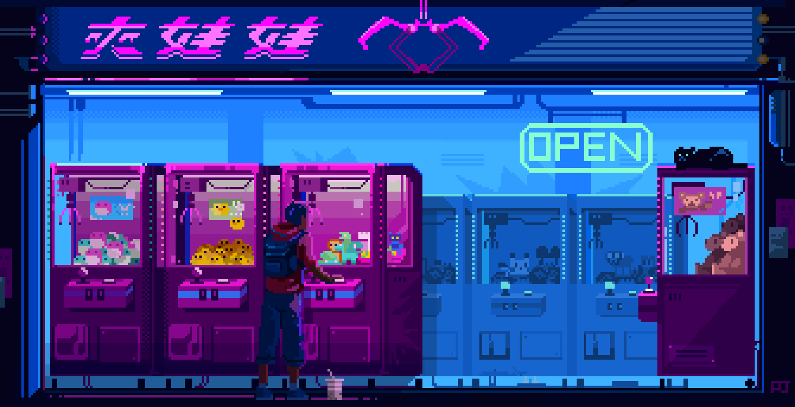

 

Background GIF by [ArtStation](https://id.pinterest.com/pin/474989091961400056/) on [Pinterest](https://www.pinterest.com/).

# Rakyavara Artomily

**Backend & Web3 Engineer**

*Payment Rails · Risk Automation · AI Agents*

 

[Portfolio](https://artomily.my.id) · [LinkedIn](https://www.linkedin.com/in/rakyavara-artomily) · [X](https://x.com/rakaalts) · [Email](mailto:hello@artomily.my.id)

---

### What I Actually Build

I engineer production systems end to end — from backend architecture and payment infrastructure to autonomous agents and onchain financial automation.

I focus on building systems that are reliable, deterministic, and designed to solve real-world problems.

| Project | What it does | Technology |
|:---|:---|:---|
| **[Tahansoe](https://github.com/sewunodetech/tahansoe)** | Non-custodial liquidation protection for Aave V3 borrowers on Arbitrum. Deterministic risk engine, Safe module execution, and live Health Factor simulation. | Next.js · TypeScript · Solidity · viem · PostgreSQL |
| **Jatah AI** | x402 payment layer for AI models. Pay-per-request access with hard budget caps and time-based passes. | Node.js · x402 · API Infrastructure |
| **xFlame** | Stellar/Soroban auto-split vault with email-based onboarding and seedless user experience. | Soroban · React · Stellar |
| **Webkitin** | Product engineering studio focused on building digital products and scalable software systems. | Next.js · TypeScript · Framer Motion |

---

### Proof of Work

- 🏆 **Winner** — Base Onchain Hackathon ($10K prize pool).
- 🌏 **Selected Founder** — Arbitrum Founder House, Singapore 2026 (1 of 120).
- 🌟 **Grant Recipient** — Stellar Community Fund.
- 🥈 **Finalist** — MetaMask Dev Cook Off.

---

### Engineering Stack

**Backend**
 
Node.js · TypeScript · Python · FastAPI · PostgreSQL · Redis

**Frontend**
 
Next.js · React · Tailwind CSS

**Web3 & Payments**
 
Solidity · Soroban · viem · wagmi · Safe Modules · x402

**Infrastructure**
 
Docker · Linux VPS · CI/CD · Neon · Vercel

---

### GitHub Analytics

<table>
  <tr>
    <td width="50%" align="center">
      
    </td>
    <td width="50%" align="center">
      
    </td>
  </tr>
</table>

  

---

### Contribution Activity

  <picture>
    <source
      media="(prefers-color-scheme: dark)"
      srcset="https://raw.githubusercontent.com/artomily/artomily/output/github-contribution-grid-snake-dark.svg"
    />
    <source
      media="(prefers-color-scheme: light)"
      srcset="https://raw.githubusercontent.com/artomily/artomily/output/github-contribution-grid-snake.svg"
    />
    
  </picture>

---

*Building from Indonesia. Engineering for the world.*

**Ship systems. Solve problems. Keep building.**

